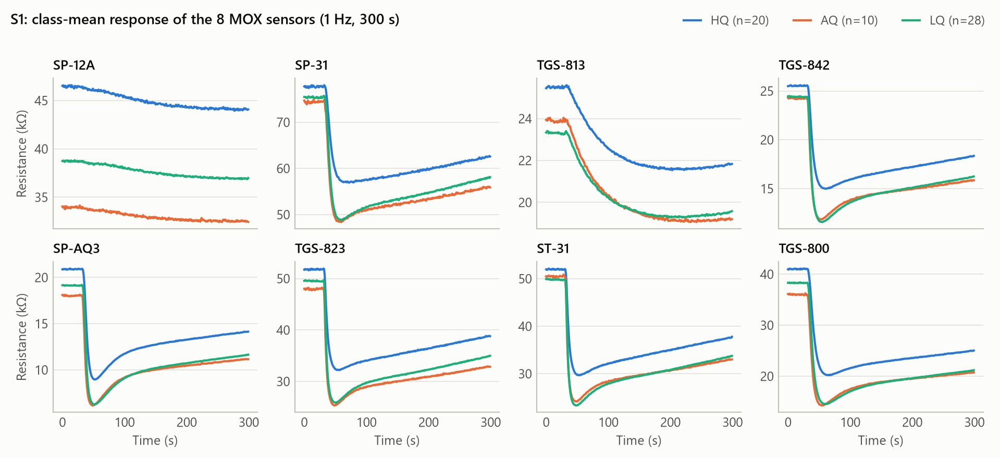
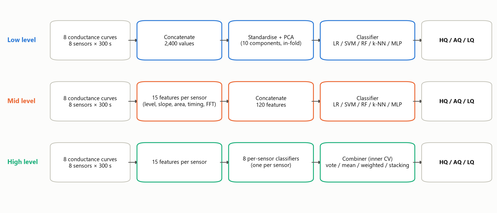
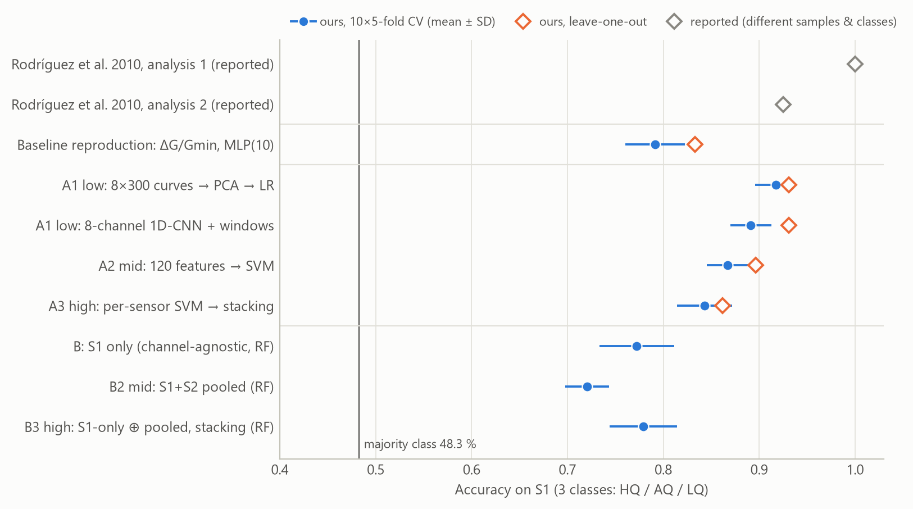
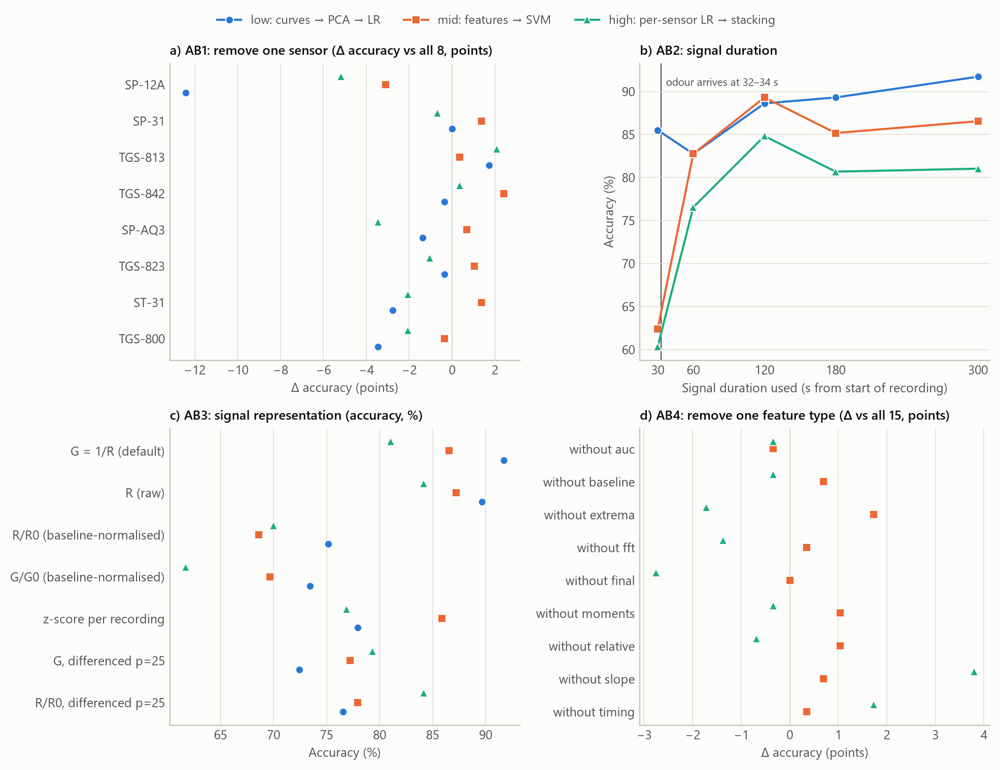

# Data Fusion and Ablation Study for Coffee Quality Assessment Using Electronic Nose Data

An electronic nose (e-nose) "smells" a sample with an array of gas sensors and lets a classifier
decide what it is. This project:

1. **reproduces** the e-nose coffee-quality method of Rodríguez, Durán & Reyes
   (*Sensors* 2010, 10(1):36–46) on its public data;
2. **compares low-, mid- and high-level data fusion** under one leakage-free evaluation protocol;
3. runs **fifteen ablation studies** to find out what actually drives the accuracy.

Only three public data sources are used, and no samples are paired across data sets.

| ID | Data set | Used for |
|---|---|---|
| **S1** | [Coffee e-nose data](https://doi.org/10.17632/7spd6fpvyk.1): 58 recordings, 8 metal-oxide sensors, high / average / low quality (HQ / AQ / LQ) | Reproduction, Experiment A |
| **S2** | [SmellNet-Base](https://github.com/MIT-MI/SmellNet) (ICLR 2026): 50 substances × 6 days, 6 gas channels, ingredient-level GC-MS vectors | Experiments B and D |
| **S3** | [CQI coffee-quality database](https://github.com/jldbc/coffee-quality-database): 1,338 cupping reviews | Experiment C |


*Class-mean resistance of the eight S1 sensors. The coffee headspace reaches the sensors at 32–34 s in every recording.*

---

## Key results

| Question | Finding |
|---|---|
| Does the reference method reproduce? | The PCA view does: the first two components explain **99.55 %** of the variance (99.62 % reported). The ten-neuron network reaches **83.3 %** with leave-one-out (LOO) and **79.1 %** with repeated 5-fold cross-validation. The paper reports 100 % and 92.5 %, but on different, smaller sets of classes. |
| Which fusion level is best for the 8 sensors? (Exp. A) | Low level **91.7 ± 2.1 %**, mid level **86.7 ± 2.2 %**, high level **84.3 ± 2.9 %** (repeated 5-fold CV). |
| …but why? (ablations) | The **first 30 s, before any odour reaches the sensors, already give 85.5 %**. Much of the low-level advantage comes from sensor levels that differ between sessions. On level-free signals, mid-level fusion is best (**85.9–87.2 %**). |
| Does adding a second gas-sensor data set help? (Exp. B) | No. Pooling SmellNet into training costs **5–17 points**. The cause is the sensor mismatch, not the amount of data: 10 % of SmellNet hurts as much as 100 %. |
| Can cupping metadata predict quality? (Exp. C) | Only weakly: about **50 %** at every fusion level (chance 33 %). Low grades are marked by cup defects, which is what an e-nose targets. |
| Does GC-MS chemistry help a gas-sensor model? (Exp. D) | Used as training-time supervision, it gives **+0.9 to +1.9 points** with SmellNet's MLP backbone. Concatenated as an input, it **leaks the label**: 100 % with the true class's vector, 5.2 % with a label-free vector. |
| How reliable is LOO model selection on 58 recordings? | Choosing the best pipeline by LOO is **optimistic by about 4 points**, so repeated CV is reported alongside it. |

<p align="center">
  <br>
  <em>The three fusion levels compared in Experiment A.</em>
</p>

<p align="center">
  <br>
  <em>Accuracy on S1. Dots: repeated 5-fold CV (mean ± SD). Hollow diamonds: LOO. Grey diamonds: values reported by Rodríguez et al. for different samples and classes.</em>
</p>

<p align="center">
  <br>
  <em>S1 ablations: (a) removing one sensor, (b) signal duration with the measured odour onset, (c) signal representation, (d) removing one feature type.</em>
</p>

---

## Where to start reading

| File | What it is |
|---|---|
| `article/article.md` | The full write-up: methods, results, discussion and references. |
| `docs/data_notes.md` | Data checks, cleaning decisions and the discrepancies we found. |
| `docs/literature_review.md` | Literature review; every reference was verified. |
| `notebooks/` | Step-by-step notebooks: exploration (`01_*`) and one notebook per experiment (`02`–`07`). |

---

## Quick start

All commands run from the repository root. They were tested on Windows with Python 3.12; bash commands work in Git Bash.

### 1. Set up the environment

```powershell
python -m venv .venv
.venv\Scripts\python -m pip install torch==2.15.0 --index-url https://download.pytorch.org/whl/cpu
.venv\Scripts\python -m pip install -r requirements.txt
```

Exact versions of every package are listed in `requirements.lock.txt`.

### 2. Download the data

The data are not stored in this repository. Download them from the original sources (pinned versions; checksums in `docs/data_notes.md`):

```bash
mkdir -p data/raw/s1 data/raw/s2 data/raw/s3

# S1: Mendeley "Download All" archive
curl -L -o data/raw/s1/dataset.zip "https://data.mendeley.com/public-files/datasets/7spd6fpvyk/files/5a5b1805-6550-4313-9f2b-53790113a67b/file_downloaded"
(cd data/raw/s1 && unzip dataset.zip)

# S2: SmellNet code (pinned commit) and data from Hugging Face (writes MANIFEST.json with SHA-256 hashes)
git clone https://github.com/MIT-MI/SmellNet.git data/raw/s2/SmellNet-code
git -C data/raw/s2/SmellNet-code checkout dde1eb01a859c13789d2b226398a542f0777fc42
.venv/Scripts/python -I src/utils/download_s2.py data/raw/s2/hf

# S3: CQI database
git clone https://github.com/jldbc/coffee-quality-database.git data/raw/s3/coffee-quality-database
```

### 3. Run the experiments

Use the virtual environment's Python (`.venv/Scripts/python`, shown as `python` below). Each cross-validation fold is checkpointed under `results/runs/<exp>/folds/`, so a run that is interrupted continues where it stopped. A finished experiment with the same configuration is loaded instead of recomputed; delete `results/runs/<exp>/` to force a rerun.

| Step | Command | Time (4-core laptop CPU) |
|---|---|---|
| Baseline reproduction | `python -m src.experiments.s1_baseline` | ~50 min |
| Experiment A: fusion of the 8 sensors | `python -m src.experiments.expA_s1_fusion main`, then `... cnn` | ~30 + 60 min |
| S1 ablations (AB1–AB7, AB10) | `python -m src.experiments.expA_s1_fusion ablations` | several hours |
| Experiment B: S1 + SmellNet | `python -m src.experiments.expB_s1_s2 b2`, `... b1`, `... ablations` (AB8) | 1 h + 1 h + several hours |
| Experiment C: CQI database (incl. AB9) | `python -m src.experiments.expC_cqi` | ~2 h |
| Experiment D: sensors + GC-MS (MLP backbone) | `bash run_expD_mlp_local.sh`, then `python -m src.experiments.expD_smellnet collect` | ~3 h |
| Leakage demonstration | `python -m src.experiments.expD_smellnet leak` | 1 min |

`run_queue.sh` and `run_s1_chain.sh` run several of these one after another, which keeps peak memory low on a laptop. `notebooks/colab_expD_gpu.ipynb` runs the Experiment D sweep on a Colab GPU for other backbones (CNN, LSTM, Transformer).

### 4. Regenerate tables, figures and notebooks

```bash
python -m src.utils.article_tables        # article/tables.md, from the logged results
python -m src.utils.article_figures       # article/figures/fig1-fig6
python -m src.utils.make_eda_notebooks    # notebooks/01_eda_*.ipynb
python -m src.utils.make_result_notebooks # notebooks/02-07_*.ipynb
jupyter nbconvert --to notebook --execute --inplace notebooks/0*.ipynb
```

No number in the article is typed by hand. Every table is generated from the files in `results/`.

---

## How the evaluation avoids optimistic results

- **Splits by recording.** Every scaler, PCA, grid search, fusion weight and stacking model is fitted inside the training folds only.
- **S1:** leave-one-out (for comparability with the paper) *and* stratified 5-fold CV repeated 10 times (5 times for the ablations). The SVM's `C` is chosen by nested CV.
- **S3:** stratified 5-fold CV repeated 5 times. The ten sensory scores add up to the target score, so they are reported only as an upper bound.
- **S2 / Experiment D:** training on days 1–4, model selection on day 5, a single test on day 6. At test time the model receives sensor data only.
- **Metrics and tests:** accuracy, balanced accuracy and macro-F1 (mean ± SD); Wilcoxon signed-rank tests over CV repeats and exact McNemar tests on the LOO predictions.

## Reproducibility

- **Seeds** are fixed: CV split seeds 0–9, model seed = 1000 × repeat + fold, and seeds 42, 7 and 123 for Experiment D.
- **`results/runs/<exp>/`** stores each experiment's `config.json` (settings, runtime, library versions), `summary.csv` and per-sample predictions (`predictions.csv.gz`). Experiment D also stores per-run scores.
- **Logged results:** every reported number comes from these files. Values taken from papers are labelled "reported".

## Repository layout

```
src/
  data/loaders.py          loaders for S1, S2 (sessions + GC-MS) and S3 (documented cleaning)
  features/enose.py        signal representations, the paper's static parameter, 15 per-sensor features
  fusion/fusion.py         high-level fusion: vote, mean, weighted, stacking (inner CV)
  models/                  classifiers (LR, SVM, RF, kNN, MLP, GB), 1D-CNN, channel-agnostic CNN
  evaluation/cv.py         CV runner with fold checkpoints, metrics, Wilcoxon and McNemar tests
  experiments/             s1_baseline, expA_s1_fusion, expB_s1_s2, expC_cqi, expD_smellnet
  utils/                   data download, reference checks, table/figure/notebook generators
notebooks/                 01_eda_s1|s2|s3, 02-07 one per experiment, colab_expD_gpu
results/                   result tables (*.csv), ablations/, figures/, runs/<exp>/
article/                   article.md, tables.md, figures/
docs/                      data notes, literature review, verified reference metadata, images/
```

## Main references

- J. Rodríguez, C. Durán, A. Reyes. Electronic nose for quality control of Colombian coffee through the detection of defects in "cup tests". *Sensors* 10(1):36–46, 2010. [doi:10.3390/s100100036](https://doi.org/10.3390/s100100036)
- J. C. Rodriguez Gamboa. Dataset: Electronic nose for quality control of Colombian coffee… Mendeley Data, v1, 2020. [doi:10.17632/7spd6fpvyk.1](https://doi.org/10.17632/7spd6fpvyk.1)
- D. Feng et al. SmellNet: A large-scale dataset for real-world smell recognition. ICLR 2026. [arXiv:2506.00239](https://arxiv.org/abs/2506.00239)
- J. LeDoux. coffee-quality-database (Coffee Quality Institute review data), 2018. [GitHub](https://github.com/jldbc/coffee-quality-database)

The full list of verified references is in `docs/literature_review.md` and `docs/references_verified.csv`.
