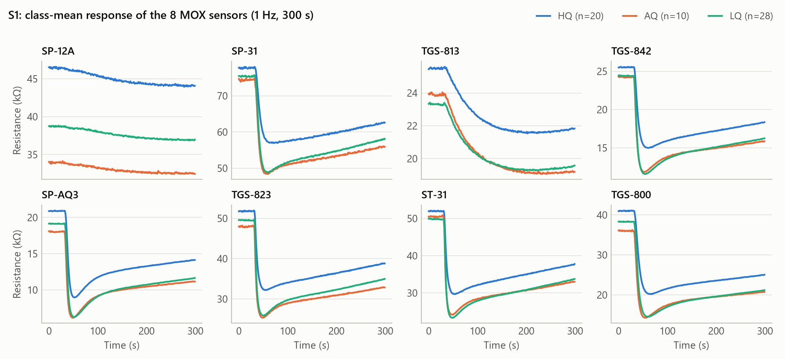
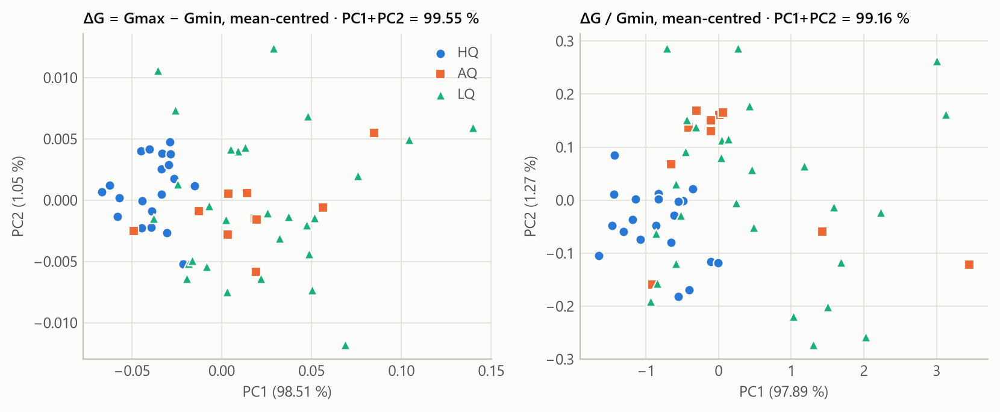
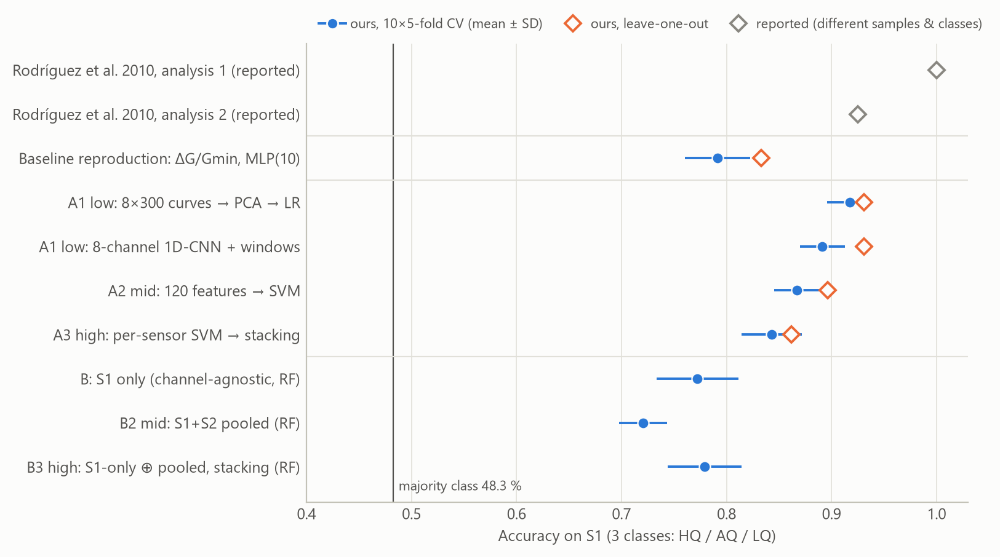
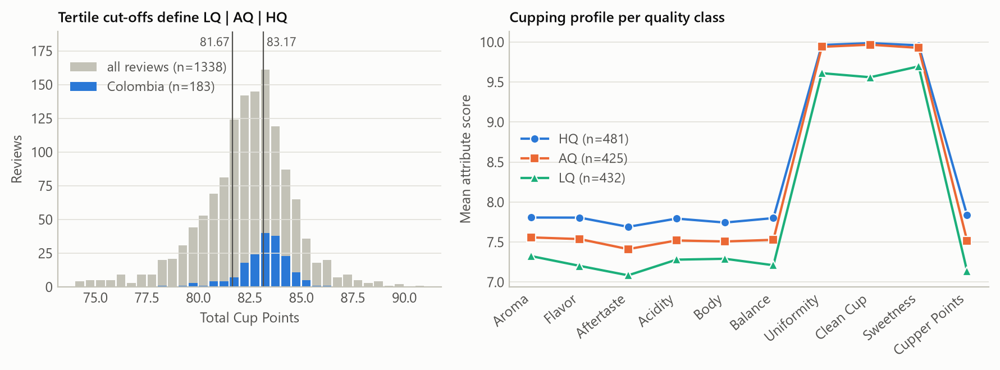
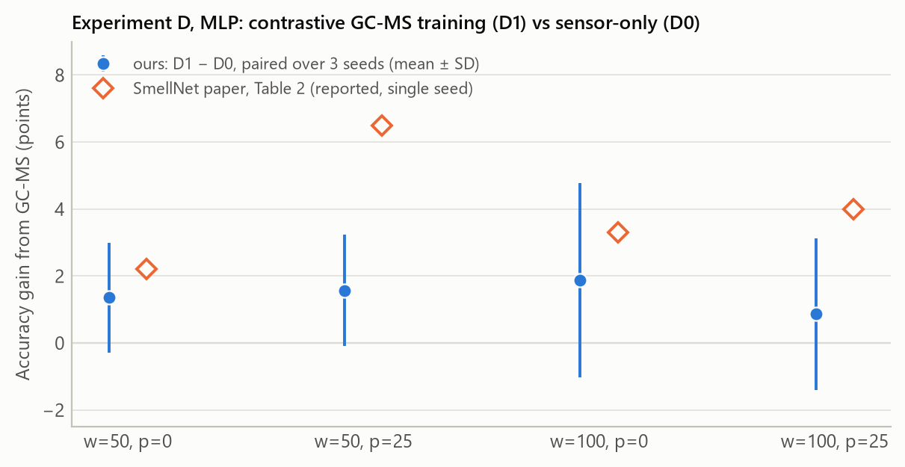
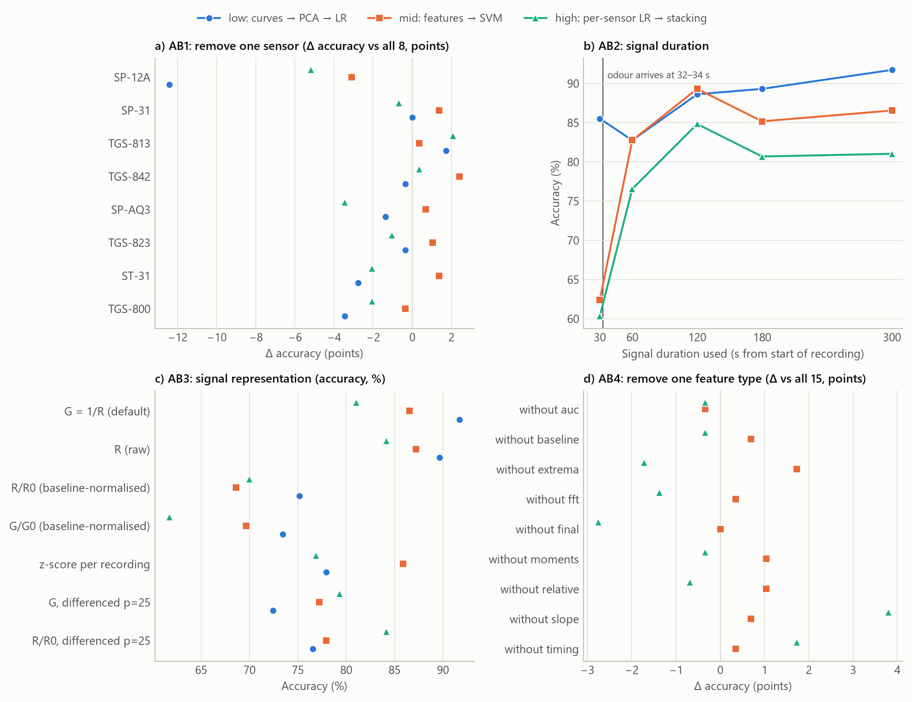

# Low-, Mid- and High-Level Data Fusion for Coffee Quality Assessment with a Low-Cost Electronic Nose: A Reproduction and Ablation Study on Public Data

*Written in the style of Rodríguez, Durán and Reyes, Sensors 2010, 10, 36–46 [18].*

---

**Abstract:** Coffee is graded by trained tasters in partly subjective cup tests. Rodríguez et al. (2010) showed that eight metal-oxide gas sensors and a small neural network can recognise coffee defects. We reproduce their pipeline on the public release of their data (58 measurements of high, average and low quality). We then compare low-level (raw signals), mid-level (features) and high-level (decisions) fusion under one leak-free protocol, using three public sources: the coffee e-nose recordings, the SmellNet gas-sensor data set with ingredient-level GC-MS vectors, and the Coffee Quality Institute cupping database. The reproduction reaches 83.3% leave-one-out (LOO) accuracy (79.1 ± 3.1% in repeated cross-validation), against 92.5–100% reported for different samples and classes, and the PCA view is reproduced closely (99.55% vs 99.62%). Fusing the full response curves of the eight sensors gives 91.7 ± 2.1%, ahead of feature-level (86.7%) and decision-level fusion (84.3%). However, the first 30 s of each recording, which precede any odour response, already give 85.5%, so much of the low-level advantage comes from the sensors' state before the sample arrives. On level-free signals, feature-level fusion of the response shape is best (85.9–87.2%). Pooling SmellNet's heterogeneous sensors lowers coffee accuracy by 5–17 points. Non-sensory cupping metadata predicts quality only weakly (about 50%) at every fusion level. Attaching class-level GC-MS vectors to test samples leaks the label (100%), whereas leak-free contrastive training gives a small gain (+0.9 to +1.9 points). Selecting models by LOO inflated accuracy by about 4 points.

**Keywords:** electronic nose; coffee quality; data fusion; metal-oxide gas sensors; ablation study; machine olfaction; data leakage; reproducibility

---

## 1. Introduction

Coffee is graded for export by trained tasters in cup tests. These tests are effective, but they depend on the taster's training and condition and are partly subjective. Q-certified cuppers and a trained descriptive panel describing the same Colombian coffees agreed little [1], and total cupping scores from different cupping centres differ by about 3 points on the 100-point scale [2]. Gas chromatography–mass spectrometry (GC-MS) identifies the volatile compounds behind coffee aroma precisely [3], but it is expensive and laborious. Electronic noses, arrays of broadly selective gas sensors followed by pattern recognition [4,5], sit between the two: they are cheap and fast and respond to the whole volatile "fingerprint" of a sample, and they have found applications across the food industry [6].

Coffee was one of the first e-nose applications [7]. Later work used neural and fuzzy-neural classifiers [8], validated commercial e-noses for coffee quality control [9], discriminated brands and blends [10,11,15], monitored ripening, roasting and packaging time [12,13,14,16], and predicted sensory descriptors and aroma intensity [11,17]. Rodríguez, Durán and Reyes [18] built the A-NOSE, an array of eight MOX sensors. From each sensor they took the variation between maximum and minimum conductance; with mean-centring, PCA and a feed-forward network with ten hidden neurons, they classified Colombian coffee samples with defects found in cup tests at 100% and 92.5% leave-one-out accuracy (16 and 35 measurements). The recordings behind that work were later released publicly [19]. They are among the very few raw e-nose coffee data sets available, and the SmellNet machine-olfaction benchmark lists them as prior sensor-based olfaction data [20].

Two questions remain open for such data. The first is **at which level information should be combined.** The data-fusion literature distinguishes low-level (data), mid-level (feature) and high-level (decision) fusion [21,22]. Multi-level fusion helped in e-nose + e-tongue tea grading [23] and coffee cultivar discrimination [24], but high-level fusion of weak components can also fail [25]. The second is **how reliable reported accuracies are.** With a few dozen measurements, leave-one-out estimates are high-variance and become optimistically biased as soon as any choice is tuned on the same folds [26,27], and class-level side information can leak the label [28].

This study answers both questions on public data, using exactly three sources: the coffee e-nose recordings of [19] (S1), SmellNet-Base (S2) [20], and the Coffee Quality Institute (CQI) cupping database (S3) [29]. The contributions are:

1. a reproduction of the reference method [18] on the public three-class data, reporting repeated cross-validation alongside leave-one-out;
2. a comparison of low-, mid- and high-level fusion of the eight sensors of S1 under one leak-free protocol (Experiment A);
3. a test of whether pooling a second, heterogeneous MOX data set (S2) helps coffee quality classification, using channel-agnostic models (Experiment B);
4. a fusion study of the non-sensory attribute groups of the CQI database and an analysis of what the quality grades mean in cupping terms (Experiment C);
5. a leakage-free study of sensor + GC-MS fusion in SmellNet, which shows why low-level fusion with class-level chemistry is invalid (Experiment D, a sub-experiment, run for the MLP model family);
6. ablations of sensors, signal duration, representation, feature types, combiners, classifier family, validation scheme and data source.

## 2. Experimental Section

### 2.1. Data sources

**S1, coffee e-nose recordings [19].** The data set holds 58 measurements of roasted, ground Colombian coffee labelled high (HQ, n = 20), average (AQ, n = 10) and low quality (LQ, n = 28). Each file contains 300 s at 1 Hz of the resistance (kΩ) of the eight MOX sensors of the A-NOSE (Table 1); the files are complete, with no missing values. The class labels of the public release do not map one-to-one onto the four groups and nine categories of [18], so comparisons with [18] are approximate. Figure 1 shows the class-mean responses. Every recording has a flat pre-exposure baseline of about 30 s, a sharp drop in resistance when the coffee headspace arrives (minimum after about 50–60 s for six of the eight sensors) and a slow recovery. The HQ curves are clearly separated from the others, while AQ and LQ nearly overlap on seven of eight sensors. The baseline resistance, measured before the coffee arrives, already differs between classes (e.g., SP-12A, mean of the first 20 s: 46.4, 33.9 and 38.7 kΩ for HQ, AQ and LQ). Coffee aroma cannot cause such a difference, which points to session or drift effects [32]; we return to this in Section 3.6.

**Table 1.** Sensors of the A-NOSE (from [18]).

| Sensor | Stated application |
|---|---|
| SP-12A | Flammable gases |
| SP-31 | Organic solvents |
| TGS-813 | Combustible gas |
| TGS-842 | Methane, natural gas |
| SP-AQ3 | Air quality control |
| TGS-823 | Combustible gases |
| ST-31 | Organic solvents |
| TGS-800 | Air quality, smoke, benzene |

**Figure 1.** Class-mean responses of the eight sensors in S1 (resistance, 1 Hz). HQ separates clearly; AQ and LQ nearly overlap on seven sensors. The pre-exposure level (first ~30 s) already differs by class.

**S2, SmellNet-Base [20].** SmellNet-Base contains 50 substances (nuts, spices, herbs, fruits and vegetables; no coffee), each recorded on six different days (300 sessions; median 600 s, range 517–867 s) at 1 Hz. Its six uncalibrated channels are NO2, C2H5OH, VOC and CO (Grove Multichannel Gas Sensor V2), Alcohol (MQ-3) and LPG (MQ-5). Each substance also has one GC-MS vector derived from FooDB, shipped in two encodings: binned mass spectra (Xspec, 460 dimensions) and elemental composition (Xatom, 17 dimensions). These vectors are **class-level priors**, not per-sample measurements. We used the code at commit `dde1eb01` and the data at Hugging Face revision `45405fec`.

**S3, CQI database [29].** The cleaned files contain 1,339 cupping reviews; dropping one empty review (total score 0) leaves 1,338 (1,310 arabica, 28 robusta; 183 Colombian). Each review has ten sensory attribute scores (G1), physical/bean data (G2: moisture, category-one and category-two defects, quakers, colour, processing method, species) and origin data (G3: country, region, altitude). The robusta attribute columns were renamed to their arabica equivalents (e.g., *Salt–Acid* → *Acidity*). We verified that the total cup score equals the sum of the ten G1 attributes for 95.1% of reviews (maximum difference 0.5 points), consistent with the cupping protocol [30].

S3 shares no samples with S1 or S2, and no samples were paired across data sets.

### 2.2. Signal processing and features (S1)

Resistance R was converted to conductance G = 1/R. The reference *static parameter* is the variation between maximum and minimum conductance; [18] does not give the exact formula, so we use ΔG = Gmax − Gmin (primary) and ΔG/Gmin (variant). For the fusion experiments we computed 15 features per sensor from the conductance curve, following common e-nose practice [31]:
- baseline (mean of the first 20 s, before the odour arrives), maximum, minimum, ΔG;
- relative peak change from baseline, mean, standard deviation;
- area under the baseline-subtracted curve;
- maximum and minimum first derivative;
- time of the largest deviation from baseline;
- final value (mean of the last 10 s);
- the magnitudes of the three lowest non-DC Fourier components.

All of these are computed from a single recording, so they cannot leak information between folds.

### 2.3. Fusion schemes

- **Low-level (A1).** (a) The 8 × 300 conductance curves are flattened to 2,400 values, standardised and reduced to 10 principal components inside each training fold before a classifier. (b) A two-layer one-dimensional CNN takes the eight sensors as input channels. It is optionally trained on sliding 250-s windows (stride 10 s), with test-time averaging over the windows of a measurement, so windows never cross folds.
- **Mid-level (A2).** The 8 × 15 per-sensor features are concatenated (120 values), standardised in-fold and classified.
- **High-level (A3).** One classifier is trained per sensor on its 15 features. The eight decisions are then combined by majority vote, mean probability, accuracy-weighted mean probability (weights proportional to above-chance inner-CV accuracy) or stacking (a logistic-regression meta-learner on inner-CV out-of-fold log-probabilities) [33]. Weights and meta-learner are fitted by a five-fold inner cross-validation inside each outer training fold.
- **S1 + S2 (B).** S1 has eight channels and S2 six, with no one-to-one correspondence, so we use channel-agnostic designs. Harmonisation:
  - S1 is converted to conductance so that both sources rise with gas;
  - both are cut to a common 300 s;
  - both are z-scored per measurement and channel.

  B1 (low level) applies a shared univariate CNN encoder to every channel and pools the channel embeddings by mean and maximum. B2 (mid level) computes the 15 features per channel and aggregates them across channels (mean, standard deviation, maximum, minimum: 60 values). Both are trained on a joint label space (3 coffee classes + 50 substances) and evaluated **only on held-out S1 measurements**, by taking the argmax over the coffee classes. B3 (high level) combines an S1-only model with the pooled model (mean, weighted, stacking). S2 sessions from days 1–5 enter only the training side, and S2 day 6 serves as a secondary check.
- **S3 (C).** The target is the tertile of the total score (LQ < 81.67 ≤ AQ < 83.17 ≤ HQ; n = 432 / 425 / 481). C1 (low level) concatenates the encoded G2 + G3 columns. C2 (mid level) concatenates per-group PCA embeddings (5 components for G2, 10 for G3, fitted in-fold). C3 (high level) trains one model per group and combines the two with the four combiners. Because the target is a sum of G1, G1 serves only as a labelled upper bound.
- **Sensor + GC-MS (D).** D0 is a sensor-only classifier (cross-entropy). D1 is SmellNet's cross-modal contrastive training (a symmetric InfoNCE loss as in CLIP [34]); it predicts the most similar of the 50 GC-MS class embeddings. D2 is a joint objective (cross-entropy + λ · contrastive). D3 is a decision-level ensemble α · softmax(D0) + (1 − α) · softmax(D1/τ). At test time the input is always sensor data only. SmellNet's own model classes, preprocessing (first-row subtraction, differencing x(t) − x(t − p), windows of size w with stride w/2, standardisation with training statistics) and loss were used unchanged.

### 2.4. Classifiers

We used five classifiers, with class weights balanced where supported:
- logistic regression (L2, C = 1);
- an RBF-kernel SVM, with C tuned over {1, 10, 100} by an inner three-fold grid search (nested cross-validation);
- random forest (300 trees);
- k-nearest neighbours (k = 5);
- a one-hidden-layer MLP with ten units, the size used in [18].

Histogram gradient boosting was added for S3. The S1 CNNs were trained with AdamW (learning rate 3 × 10⁻³, weight decay 10⁻³, 150 epochs; fixed in advance). In Experiment D, models were trained for at most 90 epochs (batch 32) with early stopping after 25 epochs without improvement on the validation day; the learning rate {3 × 10⁻⁴, 10⁻³, 3 × 10⁻³}, λ ∈ {0.1, 0.5, 1} and α ∈ {0, 0.25, 0.5, 0.75, 1} were also chosen on that day.

### 2.5. Validation and statistics

- **S1:** leave-one-out (for comparison with [18]; repeated over three network initialisations for the baseline) and stratified five-fold cross-validation repeated ten times with fixed seeds. Everything learned from data (scaling, PCA, tuning, combiner weights, meta-learners) is fitted inside training folds only.
- **S3:** stratified five-fold cross-validation repeated five times. Imputation and encoding are fitted in-fold.
- **S2 / Experiment D:** training on days 1–4; learning rate, λ, α and checkpoint selected on day 5; the official test day 6 used once. Windows are cut after splitting. This uses one training day fewer than [20], whose code contains no validation split.

Metrics are accuracy, balanced accuracy and macro-F1 (mean ± standard deviation over cross-validation repeats or seeds). Paired comparisons use the Wilcoxon signed-rank test on per-repeat accuracies and McNemar's exact test on leave-one-out predictions [35,36]. Given the small S1 sample, p-values are interpreted with caution. Every number reported here comes from a logged run, and configurations, seeds and per-sample predictions are stored with the code.

### 2.6. Ablation design

Each ablation changes one factor and keeps everything else fixed, using one reference model per fusion level (low: A1a with LR; mid: A2 with SVM; high: A3 with LR base and stacking) and 5 × 5 repeated cross-validation:
- **AB1:** leave one sensor out; single sensor only.
- **AB2:** signal duration (first 30, 60, 120, 180 or 300 s).
- **AB3:** representation (R, G, R/R0, G/G0, per-recording z-score, with and without differencing).
- **AB4:** removal of each feature type.
- **AB5–AB7:** combiners, classifier families, and LOO versus repeated five-fold, all from the main runs.
- **AB8:** amount of S2 (10–100%) and each harmonisation step in Experiment B.
- **AB9:** removal of each CQI group.
- **AB10:** sliding-window augmentation for the CNN.
- **AB11–AB16:** Experiment D factors (with versus without GC-MS, encoding, window and differencing, channel masking, λ and α).

## 3. Results and Discussion

### 3.1. Reproduction of the reference method

Figure 2 shows the PCA of the static parameter, analogous to Figures 7 and 9 of [18]. With mean-centring, the first two components explain 99.55% of the variance of ΔG (Table 2), close to the 99.62% reported in [18]. This figure is mostly a consequence of mean-centring without scaling, though: the sensors with the largest ΔG dominate PC1 (SP-AQ3 alone has a loading of 0.85), and after autoscaling the two components explain 93.58%. As in [18], the HQ measurements form a compact group, while AQ and LQ overlap.

**Figure 2.** PCA of the static parameter of the eight sensors (S1, mean-centred), coloured by quality class. Left: ΔG = Gmax − Gmin; right: ΔG/Gmin.

**Table 2.** Explained variance of the first two principal components of the static parameter.

| Feature | Scaling | PC1 % | PC2 % | PC1+PC2 % |
|---|---|---|---|---|
| ΔG = Gmax − Gmin | mean-centring | 98.51 | 1.05 | 99.55 |
| ΔG = Gmax − Gmin | autoscaling | 78.7 | 14.88 | 93.58 |
| ΔG / Gmin | mean-centring | 97.89 | 1.27 | 99.16 |
| ΔG / Gmin | autoscaling | 76.31 | 15.39 | 91.7 |

Table 3 reports the ten-hidden-unit MLP for every combination of feature, input scaling and solver. Read literally (ΔG = Gmax − Gmin, mean-centring, gradient descent with adaptive learning rate), the network barely leaves the majority class: 51.7 ± 7.5% LOO, where predicting LQ for every sample gives 48.3%. The reason is scale: absolute ΔG values are tiny (about 0.001–0.2 mS), so the inputs barely move the network. A scale-free version of the parameter (ΔG/Gmin) reaches **83.3 ± 1.0% LOO** (79.1 ± 3.1% in 10×5-fold), the best LOO result of the reproduction. The paper's 100% and 92.5% were obtained on 16 and 35 measurements with four and nine classes, so the gap partly reflects different samples, classes and the high variance of LOO on few measurements.

**Table 3.** Reproduction of the reference pipeline on S1 (MLP with 10 hidden units; LOO repeated over three initialisations; mean ± SD).

| Feature | Input scaling | Solver | LOO acc. % (3 inits) | 10×5-fold acc. % | Macro-F1 (5-fold) |
|---|---|---|---|---|---|
| ΔG = Gmax − Gmin | none | SGD | 51.1 ± 6.5 | 55.5 ± 5.8 | 0.347 |
| ΔG = Gmax − Gmin | none | Adam | 69.0 ± 1.7 | 69.8 ± 4.7 | 0.534 |
| ΔG = Gmax − Gmin | mean-centring | SGD | 51.7 ± 7.5 | 54.7 ± 5.7 | 0.334 |
| ΔG = Gmax − Gmin | mean-centring | Adam | 71.8 ± 3.6 | 70.7 ± 3.9 | 0.556 |
| ΔG = Gmax − Gmin | autoscaling | SGD | 70.7 ± 3.4 | 73.4 ± 3.9 | 0.684 |
| ΔG = Gmax − Gmin | autoscaling | Adam | 75.3 ± 2.0 | 74.0 ± 4.2 | 0.687 |
| ΔG / Gmin | none | SGD | 72.4 ± 3.0 | 73.3 ± 2.7 | 0.622 |
| ΔG / Gmin | none | Adam | 71.8 ± 5.5 | 73.8 ± 4.7 | 0.699 |
| ΔG / Gmin | mean-centring | SGD | 83.3 ± 1.0 | 79.1 ± 3.1 | 0.734 |
| ΔG / Gmin | mean-centring | Adam | 79.3 ± 1.7 | 78.3 ± 2.8 | 0.721 |
| ΔG / Gmin | autoscaling | SGD | 81.0 ± 1.7 | 80.0 ± 4.2 | 0.764 |
| ΔG / Gmin | autoscaling | Adam | 78.7 ± 2.6 | 79.7 ± 4.4 | 0.754 |

### 3.2. Experiment A: fusion of the eight sensors

Figure 3 and Table 4 summarise the fusion levels. **With the absolute (conductance) signals, low-level fusion is clearly best**; Section 3.6 shows that this ranking reverses once absolute levels are removed. Flattening the eight curves and projecting them onto ten in-fold principal components before a logistic regression gives 91.7 ± 2.1% (LOO 93.1%). The multichannel CNN reaches 88.8 ± 3.2% and, with sliding-window augmentation, 89.1 ± 2.2% (LOO 93.1%). Mid-level fusion of the 120 hand-crafted features reaches 86.7 ± 2.2% (SVM) and high-level fusion 84.3 ± 2.9% (per-sensor SVMs with stacking). Over the ten repeats, low-level fusion is significantly better than both mid- and high-level fusion (Wilcoxon p = 0.002 in both cases), whereas mid and high level do not differ significantly (p = 0.25). On the 58 LOO predictions, McNemar's test finds no significant difference (Table 5), a reminder of how little a single LOO pass can resolve. Every fusion level beats the reproduced baseline (79.1% in 10×5-fold).

**Figure 3.** Accuracy on S1 for the reproduced baseline, the three fusion levels (Experiment A) and fusion with S2 (Experiment B). Dots with bars: 10×5-fold CV (mean ± SD); hollow diamonds: leave-one-out; grey diamonds: values reported in [18] for different samples and class definitions.

**Table 4.** Experiment A: accuracy (%) by classifier and fusion level (10×5-fold mean ± SD; LOO in brackets).

| Classifier | Low (A1a) % | Mid (A2) % |
|---|---|---|
| LR | 91.7 ± 2.1 (LOO 93.1) | 84.7 ± 2.1 (LOO 87.9) |
| SVM | 91.0 ± 2.4 (LOO 94.8) | 86.7 ± 2.2 (LOO 89.7) |
| RF | 84.5 ± 2.7 (LOO 82.8) | 82.1 ± 4.2 (LOO 82.8) |
| kNN | 83.1 ± 4.0 (LOO 84.5) | 81.9 ± 3.1 (LOO 84.5) |
| MLP | 85.0 ± 4.8 (LOO 84.5) | 86.6 ± 3.1 (LOO 81.0) |

| Per-sensor model (A3) | vote | mean | weighted | stacking |
|---|---|---|---|---|
| LR | 75.2 ± 3.8 (LOO 77.6) | 76.6 ± 2.0 (LOO 77.6) | 75.3 ± 2.9 (LOO 75.9) | 81.0 ± 2.6 (LOO 79.3) |
| SVM | 82.8 ± 1.4 (LOO 84.5) | 83.3 ± 1.4 (LOO 84.5) | 82.8 ± 1.6 (LOO 82.8) | 84.3 ± 2.9 (LOO 86.2) |

**Table 5.** Paired tests between the best model of each level.

| Comparison | Acc. A / B (5-fold) % | Wilcoxon p (10 repeats) | LOO: only A / only B correct | McNemar p (LOO) |
|---|---|---|---|---|
| A1a\|LR vs A2\|SVM | 91.7 / 86.7 | 0.002 | 4 / 2 | 0.688 |
| A1a\|LR vs A3\|SVM\|stacking | 91.7 / 84.3 | 0.002 | 5 / 1 | 0.219 |
| A2\|SVM vs A3\|SVM\|stacking | 86.7 / 84.3 | 0.250 | 2 / 0 | 0.500 |

**Where the errors are.** HQ is almost never missed (recall 0.94–1.00 for every model in Table 6). The smallest class, AQ (n = 10), is the hard one, and most errors are AQ↔LQ confusions, matching the overlap of their curves in Figure 1. Low-level fusion owes most of its advantage to AQ: its AQ recall is 0.80 against 0.57 for mid-level and 0.54 for high-level fusion in 10×5-fold CV. Among the combiners, stacking is the best for both per-sensor model families, and simple voting or averaging over eight individually weak sensors loses information (Table 4), in line with [25]. Section 3.6 asks *what* the low-level models exploit.

**Table 6.** Per-class recall and error structure on S1.

| Model | Validation | Recall HQ / AQ / LQ | Errors | of which AQ↔LQ |
|---|---|---|---|---|
| Baseline (ΔG/Gmin, MLP) | LOO | 0.95 / 0.50 / 0.89 | 9 | 5 (56%) |
| A1a\|LR | LOO | 1.00 / 0.80 / 0.93 | 4 | 3 (75%) |
| A1b\|CNN+win | LOO | 1.00 / 0.80 / 0.93 | 4 | 3 (75%) |
| A2\|SVM | LOO | 1.00 / 0.60 / 0.93 | 6 | 4 (67%) |
| A3\|SVM\|stacking | LOO | 1.00 / 0.50 / 0.89 | 8 | 6 (75%) |
| A1a\|LR | 10×5-fold (pooled) | 0.99 / 0.80 / 0.91 | 48 | 31 (65%) |
| A2\|SVM | 10×5-fold (pooled) | 0.94 / 0.57 / 0.92 | 77 | 39 (51%) |
| A3\|SVM\|stacking | 10×5-fold (pooled) | 0.95 / 0.54 / 0.88 | 91 | 57 (63%) |

### 3.3. Experiment B: fusion of S1 with SmellNet

Table 7 compares each fused model with the identical model trained on S1 alone, on the same folds. **Pooling SmellNet into training hurts coffee classification at every level:**
- mid-level pooling lowers accuracy by 12.2 (LR), 5.2 (RF) and 9.7 points (MLP), all significant (p ≤ 0.008);
- low-level pooling with the channel-agnostic CNN lowers it by 17.2 points (p = 0.062 with five repeats).

Decision-level fusion (B3) at best recovers the S1-only level (RF stacking 77.9% vs 77.2%, p = 0.84). The pooled models did learn SmellNet, reaching 32–38% on its unseen sixth day in the 50-way task, so the auxiliary data is usable; it just does not transfer to coffee. The sensors differ in type, units and response dynamics, and the only common representation we can build without matching channels discards channel identity. Even trained on S1 alone, the channel-agnostic models lose 4.9–11.3 points against the channel-aware features of Experiment A with the same classifier (LR: 73.4% vs 84.7%; RF: 77.2% vs 82.1%). A second candidate explanation, that the 250 SmellNet sessions simply outnumber the 46 coffee measurements of a training fold, is ruled out by AB8 (Section 3.6): even 10% of the SmellNet data does as much harm.

**Table 7.** Experiment B (10×5-fold for B2/B3, 5×5-fold for B1; Δ and Wilcoxon p versus the same model trained on S1 only).

| Variant | Level | Accuracy % | Macro-F1 | Δ vs S1-only (pts) | Wilcoxon p |
|---|---|---|---|---|---|
| S1only · LR | none (S1 only) | 73.4 ± 2.7 | 0.687 | - | - |
| B2 · LR | mid | 61.2 ± 3.3 | 0.583 | -12.2 | 0.002 |
| B3 · LR · mean | high | 69.8 ± 3.8 | 0.654 | -3.6 | 0.035 |
| B3 · LR · weighted | high | 71.9 ± 2.8 | 0.672 | -1.6 | 0.172 |
| B3 · LR · stacking | high | 75.0 ± 2.6 | 0.686 | +1.6 | 0.305 |
| S1only · RF | none (S1 only) | 77.2 ± 3.9 | 0.740 | - | - |
| B2 · RF | mid | 72.1 ± 2.3 | 0.691 | -5.2 | 0.008 |
| B3 · RF · mean | high | 76.9 ± 2.3 | 0.738 | -0.3 | 0.844 |
| B3 · RF · weighted | high | 76.6 ± 2.7 | 0.736 | -0.7 | 0.562 |
| B3 · RF · stacking | high | 77.9 ± 3.5 | 0.748 | +0.7 | 0.838 |
| S1only · MLP64 | none (S1 only) | 73.6 ± 3.8 | 0.693 | - | - |
| B2 · MLP64 | mid | 64.0 ± 3.9 | 0.589 | -9.7 | 0.004 |
| B3 · MLP64 · mean | high | 72.8 ± 4.0 | 0.687 | -0.9 | 0.609 |
| B3 · MLP64 · weighted | high | 72.6 ± 4.6 | 0.685 | -1.0 | 0.438 |
| B3 · MLP64 · stacking | high | 71.7 ± 5.8 | 0.660 | -1.9 | 0.340 |
| S1only · CA-CNN | none (S1 only) | 60.7 ± 3.3 | 0.433 | - | - |
| B1 · CA-CNN | low | 43.4 ± 7.0 | 0.416 | -17.2 | 0.062 |
| B3 · CA-CNN · mean | high | 62.4 ± 4.8 | 0.493 | +1.7 | 0.750 |

### 3.4. Experiment C: fusion within the CQI database, and what the quality grades mean

Non-sensory data predicts the quality tertile only weakly, and **the fusion level hardly matters** (Table 8). The best low-level (C1, SVM), mid-level (C2, MLP) and high-level (C3, logistic regression with voting) models reach 49.6 ± 1.3%, 48.1 ± 1.5% and 49.8 ± 1.4%, against 33% chance and 35.9% for the majority class. The pairwise differences are not significant (Wilcoxon p = 0.06–0.81). Origin (G3) carries most of the signal on its own (48.6%), more than bean and physical data (G2, 43.6%). The sensory scores (G1) reach 98.1%, which is the expected consequence of the total score being their sum and is reported only as an upper bound.

**Table 8.** Experiment C (5×5-fold; best model per setting).

| Setting | Best model | Accuracy % | Balanced acc. % | Macro-F1 |
|---|---|---|---|---|
| C1 low (G2+G3 concatenated) | SVM | 49.6 ± 1.3 | 49.1 | 0.480 |
| C2 mid (per-group PCA) | MLP | 48.1 ± 1.5 | 47.6 | 0.464 |
| C3 high (per-group models) | LR · vote | 49.8 ± 1.4 | 49.6 | 0.487 |
| G2 only (bean/physical) | SVM | 43.6 ± 1.1 | 43.1 | 0.428 |
| G3 only (origin) | MLP | 48.6 ± 1.2 | 48.4 | 0.473 |
| UPPER BOUND: G1 sensory (leaky) | LR | 98.1 ± 0.3 | 98.1 | 0.981 |
| UPPER BOUND: G1+G2+G3 (leaky) | LR | 96.1 ± 0.4 | 96.1 | 0.961 |

The CQI data does, however, explain what the quality grades mean in cupping terms (Figure 4, Table 9). HQ, AQ and LQ differ by a steady 0.22–0.34 points per step on every descriptive attribute (aroma, flavour, aftertaste, acidity, body, balance). LQ is additionally marked by **cup defects**:
- about three times as many category-one defects (0.83 vs 0.28 per sample) and nearly twice as many category-two defects (5.04 vs 2.73) as HQ;
- lower Uniformity, Clean Cup and Sweetness, the attributes in which tainted cups are penalised.

This is exactly the information the A-NOSE was designed to capture. The 1.5-point width of the AQ band is also *smaller* than the roughly 3-point disagreement between cupping centres [2], which bounds how well any instrument can reproduce these grades. Colombian coffees sit mostly in the top tertile (103 of 183 reviews).

**Figure 4.** CQI database: distribution of total cup points with the tertile cut-offs (left) and mean cupping profile per quality class (right).

**Table 9.** Mean values per CQI quality class (n = 1,338).

| Mean per class | HQ | AQ | LQ |
|---|---|---|---|
| Total.Cup.Points | 84.39 | 82.42 | 79.40 |
| Uniformity | 9.96 | 9.94 | 9.61 |
| Clean.Cup | 9.99 | 9.97 | 9.56 |
| Sweetness | 9.96 | 9.93 | 9.70 |
| Category.One.Defects | 0.28 | 0.35 | 0.83 |
| Category.Two.Defects | 2.73 | 2.98 | 5.04 |
| Moisture | 0.08 | 0.09 | 0.10 |
| altitude_mean_meters | 1425 | 1309 | 1237 |
| n | 481 | 425 | 432 |

### 3.5. Experiment D: sensor + GC-MS fusion in SmellNet

**Low-level fusion with class-level chemistry is invalid.** SmellNet's GC-MS vectors describe ingredients, not samples. If each test window is given the GC-MS vector of its (true) substance, a GC-MS-only model and an early concatenation of sensor features with GC-MS both score 100% on the test day (Table 10). The concatenation model drops to 5.2% once the GC-MS input is replaced by the only label-free choice, the average vector, far below the 44.8% of the same model without any GC-MS. All of the apparent gain was label leakage [28]. Valid uses of class-level chemistry are training-time alignment (D1, D2) and decision-level combination with all 50 class prototypes (D3).

**Table 10.** Leakage demonstration (logistic regression, w = 100, p = 25, SmellNet test day 6). The first two rows are invalid by construction.

| System | Day-6 accuracy % |
|---|---|
| GC-MS of the true class only (LEAKY) | 100.0 |
| Sensor features + GC-MS of the true class (LEAKY) | 100.0 |
| Same model, label-free GC-MS at test | 5.2 |
| Sensor-only, same features (valid) | 44.8 |

For the MLP family (all four systems, three seeds, selection on day 5), **contrastive GC-MS training (D1) improves on sensor-only training (D0) in all four window/differencing settings**, by 0.9–1.9 points (Table 11, Figure 5). This direction agrees with [20], which reports that GC-MS helps weaker models most (+2.2 to +6.5 points for the MLP). Our gains are smaller and their seed-to-seed spread is of the same order. The joint objective D2 is on par with D0 (−0.3 to +1.7 points), and the decision ensemble D3 gains 1.0–2.2 points in three of the four settings. Masking a channel at test time shows that VOC, CO, NO2 and C2H5OH carry most of the information (−10 to −13 points each on average), while Alcohol and LPG matter least (about −4 points). The spectral GC-MS encoding was at least as good as elemental composition in every completed comparison (21.8 vs 20.3%, 26.1 vs 25.9% and 23.0 vs 21.1%; the last with one Xatom seed). Absolute accuracies are of the same order as the paper's: within 2.3 points in six of the eight D0/D1 cells, 6.4 points higher for D0 at w = 50, p = 25, and 4.0 points lower for D1 at w = 100, p = 25. Our runs train on one day fewer and select checkpoints on a separate validation day, whereas the paper's code evaluates on the test day directly. The larger models (CNN, LSTM, Transformer) were not run, to keep the scope on Experiments A–C.

**Table 11.** Experiment D, MLP family: day-6 accuracy (%, mean ± SD over 3 seeds) and the values reported in [20], Table 2 (single seed).

| Model, window, period | D0 ours % | D1 ours % | D2 ours % | D3 ours % | Paper sensor-only / cross-modal % |
|---|---|---|---|---|---|
| MLP, w=50, p=0 | 20.4 ± 1.1 | 21.8 ± 1.0 | 20.2 ± 0.8 | 19.9 ± 0.4 | 21.9 / 24.1 |
| MLP, w=50, p=25 | 24.6 ± 1.4 | 26.1 ± 0.8 | 26.2 ± 1.2 | 25.5 ± 0.3 | 18.2 / 24.7 |
| MLP, w=100, p=0 | 21.1 ± 2.1 | 23.0 ± 0.9 | 20.8 ± 2.2 | 23.3 ± 0.9 | 21.0 / 24.3 |
| MLP, w=100, p=25 | 25.9 ± 1.6 | 26.8 ± 2.7 | 25.9 ± 2.2 | 27.1 ± 2.2 | 26.8 / 30.8 |

**Figure 5.** Gain from contrastive GC-MS training (D1 − D0) for the MLP on SmellNet-Base, paired over three seeds, with the gain reported in [20].

### 3.6. Ablation studies

Table 12 and Figure 6 summarise the S1 ablations for the reference model of each fusion level (low: curves → PCA → LR; mid: features → SVM; high: per-sensor LR → stacking; 5×5 repeated cross-validation, so the *full* rows can differ slightly from Table 4).

**Sensors (AB1).** The array is largely redundant: apart from one sensor, removing any single sensor changes accuracy by between −3.4 and +2.4 points. The exception is SP-12A. Removing it lowers the low-level model from 91.7% to 79.3% (−12.4 points) but the mid- and high-level models by only 3.2 and 5.1 points. SP-12A hardly responds to the coffee: in 32 of the 58 recordings its resistance never falls 5% below its starting level (Table 13). Its *level*, however, differs strongly between classes (Figure 1). Removing TGS-813 slightly improves the low- and high-level models (93.4% and 83.1%). The most informative single sensor is TGS-800 (85.5% with mid-level features).

**Signal duration and the pre-exposure state (AB2).** The odour reaches the fast sensors 32–34 s after the start of every one of the 58 recordings (Table 13). Using only the first 30 s, which contain no odour response at all, the low-level model still classifies 85.5% of the samples correctly, whereas the mid- and high-level models fall to 62.4% and 60.3%. Much of the class information exploited by the low-level model is therefore present *before the sample arrives*. It lies in the absolute levels of the sensors, which depend on the measurement session, ambient conditions and drift [32] rather than on the coffee. Once the response is included, 120 s are enough for the mid- and high-level models (89.3% and 84.8%, at least as good as the full 300 s).

**Signal representation (AB3).**
- **Baseline normalisation.** Removing the absolute level confirms the finding above. Dividing by the baseline (R/R0 or G/G0) costs the low-level model 16.5–18.3 points (75.2% and 73.4%) and the mid-level model 16.9–18.0 points.
- **Per-recording z-score.** This removes level and scale but keeps the *shape* of each response. It leaves the mid-level features almost unchanged (85.9% vs 86.6%; 87.2% with logistic regression), while the low-level model drops to 77.9%. The shape of the response (how fast and how deep each sensor reacts and how it recovers) therefore carries genuine odour information, and **on level-free signals mid-level fusion is the best level.**
- **Differencing.** Temporal differencing, as used in SmellNet, hurts the low- and mid-level models but helps the high-level mean combiner (76.9% → 83.1%).

**Feature types (AB4).** No feature type is indispensable. Removing any one changes the mid-level SVM by −0.3 to +1.7 points and the high-level model by −2.8 to +3.8 points; the 15 features are largely redundant.

**Combiners and classifier families (AB5, AB6).**
- **Combiners.** On S1, stacking is the best combiner for both per-sensor model families (81.0% and 84.3%, against 75.2–83.3% for voting and averaging; Table 4). On S3, all four combiners stay within 1.1 points of each other for every model family.
- **Classifiers on S1.** Logistic regression and the SVM are best for low-level fusion (91.0–91.7%), ahead of random forest, k-NN and the 10-unit MLP (83.1–85.0%). At the mid level the SVM and the MLP perform alike (86.7% and 86.6%).
- **Classifiers on S3.** At the low level, logistic regression, SVM and MLP reach 48.9–49.6%, against 47.7% for random forest and 45.6% for gradient boosting.

**Validation scheme (AB7).** Across the 32 S1 pipelines, LOO and repeated five-fold differ little on average (+0.5 points; range −5.5 to +4.2). Choosing the best of many pipelines by LOO is optimistic, though:
- the LOO winner of the baseline grid scores 83.3% in LOO but 79.1% in repeated five-fold;
- the LOO winner of Experiment A (SVM on the curves, 94.8%) scores 91.0%.

That is about 4 points of selection optimism, as predicted by [26,27].

**Sliding windows (AB10).** Window augmentation changes the CNN by +0.3 points in repeated five-fold (88.8% → 89.1%) and +1.7 points in LOO, within the noise.

**CQI groups (AB9).** Origin carries more of the signal than bean and physical data: G3 alone reaches 48.6%, G2 alone 43.6%, and the fusion of both 49.6–49.8% (Table 8).

**Table 12.** S1 ablations: accuracy (%) of the reference model of each fusion level (5×5 repeated stratified CV).

| Setting | Low (A1a, LR) | Mid (A2, SVM) | High (A3, LR stacking) |
|---|---|---|---|
| Full configuration (G = 1/R, 300 s, 8 sensors) | 91.7 | 86.6 | 81.0 |
| AB1: without SP-12A | 79.3 | 83.4 | 75.9 |
| AB1: without TGS-813 | 93.4 | 86.9 | 83.1 |
| AB1: TGS-800 only | 81.0 | 85.5 | 75.5 |
| AB1: SP-12A only | 66.6 | 62.1 | 67.9 |
| AB2: first 30 s (no odour response yet) | 85.5 | 62.4 | 60.3 |
| AB2: first 60 s | 82.8 | 82.8 | 76.6 |
| AB2: first 120 s | 88.6 | 89.3 | 84.8 |
| AB3: raw resistance R | 89.7 | 87.2 | 84.1 |
| AB3: R/R0 (baseline-normalised) | 75.2 | 68.6 | 70.0 |
| AB3: G/G0 (baseline-normalised) | 73.4 | 69.7 | 61.7 |
| AB3: z-score per recording (shape only) | 77.9 | 85.9 | 76.9 |
| AB3: G, differenced (p = 25) | 72.4 | 77.2 | 79.3 |
| AB4: remove one feature type (range of Δ, points) | n/a | -0.3 to +1.7 | -2.8 to +3.8 |

**Table 13.** Onset of the odour response in S1: first second at which a sensor's resistance falls more than 5% below the mean of its first 20 s.

| Sensor | Median onset (s) | Min (s) | Max (s) | Recordings with no 5 % drop |
|---|---|---|---|---|
| SP-12A | 300 | 78 | 300 | 32 |
| SP-31 | 37 | 35 | 41 | 0 |
| TGS-813 | 53 | 42 | 62 | 0 |
| TGS-842 | 34 | 33 | 37 | 0 |
| SP-AQ3 | 35 | 33 | 40 | 0 |
| TGS-823 | 34 | 33 | 35 | 0 |
| ST-31 | 33 | 32 | 34 | 0 |
| TGS-800 | 35 | 33 | 42 | 0 |

The earliest onset among the six fast sensors is 32–34 s (median 33 s); no recording responds before 30 s.

**Figure 6.** S1 ablations for the reference model of each fusion level: (a) removal of one sensor; (b) signal duration, with the measured odour onset marked; (c) signal representation; (d) removal of one feature type (mid and high level only).

**Amount of SmellNet data and harmonisation (AB8, Table 14).**
- **Amount.** The loss from pooling does not come from SmellNet outnumbering the coffee data. With only 10% of the SmellNet sessions (25 sessions), pooled training is still 8.1–13.6 points below S1-only training (p ≤ 0.006), about as bad as, or worse than, with all 250 sessions.
- **Harmonisation.** This matters a great deal. Without the polarity correction (resistance instead of conductance), the loss of the linear model roughly doubles (−23.6 points). Without per-recording normalisation, the losses of the linear and MLP models grow to −22.6 to −37.8 points. Cutting both sources to a common length matters little (−10.0 instead of −12.2 points).
- **Differencing.** Temporal differencing almost removes the loss (−1.2, −0.5 and +2.6 points for LR, RF and MLP), but it also lowers the S1-only models to 64.1–73.8%. The only positive difference (MLP, +2.6 points) has p = 0.045 before correction for the 36 comparisons of AB8, and it leaves the pooled model at 66.7%, well below the plain S1-only random forest (77.2%).

SmellNet therefore never improves coffee classification here; careful harmonisation only limits the damage.

**Table 14.** AB8: S1-only accuracy and the change caused by pooling SmellNet into training (mid-level B2, 10×5-fold; p from the Wilcoxon signed-rank test over the 10 repeats, uncorrected).

| Setting (Experiment B2, mid level) | LR: S1-only % → Δ pooled (p) | RF: S1-only % → Δ pooled (p) | MLP64: S1-only % → Δ pooled (p) |
|---|---|---|---|
| full harmonisation, 100 % of S2 | 73.4 → -12.2 (0.002) | 77.2 → -5.2 (0.008) | 73.6 → -9.7 (0.004) |
| 10 % of S2 sessions | 73.4 → -13.6 (0.002) | 77.2 → -11.6 (0.002) | 73.6 → -8.1 (0.006) |
| 25 % of S2 sessions | 73.4 → -13.1 (0.002) | 77.2 → -9.8 (0.002) | 73.6 → -7.4 (0.008) |
| 50 % of S2 sessions | 73.4 → -13.3 (0.002) | 77.2 → -9.5 (0.004) | 73.6 → -8.4 (0.008) |
| no polarity correction (S1 as R) | 73.4 → -23.6 (0.002) | 69.1 → -6.2 (0.004) | 73.6 → -16.2 (0.002) |
| ratio x/x0 instead of z-score | 71.2 → -31.2 (0.002) | 77.8 → -9.8 (0.002) | 79.3 → -22.6 (0.002) |
| no per-recording normalisation | 71.2 → -37.8 (0.002) | 77.8 → -9.3 (0.004) | 79.3 → -29.3 (0.002) |
| S2 at full length | 73.4 → -10.0 (0.002) | 77.2 → -5.3 (0.004) | 73.6 → -7.6 (0.004) |
| differenced (p = 25) | 66.2 → -1.2 (0.211) | 73.8 → -0.5 (0.641) | 64.1 → +2.6 (0.045) |
| first 60 s | 65.5 → -3.6 (0.016) | 68.8 → -3.3 (0.096) | 63.3 → -4.1 (0.152) |
| first 120 s | 67.9 → -5.9 (0.006) | 66.2 → -5.9 (0.008) | 71.9 → -1.2 (0.680) |
| first 180 s | 72.9 → -2.9 (0.016) | 69.3 → -2.6 (0.086) | 76.9 → -1.9 (0.273) |

### 3.7. Comparison with the reference article

Table 15 is the main comparison. The rows from [18] were obtained on different measurements and class definitions (16 measurements in four groups; 35 measurements in nine categories), so they are not directly comparable with the public three-class data.

**Table 15.** Main comparison (S1 rows: LOO / 10×5-fold).

| Method | Data | Classes | Validation | Accuracy % | Macro-F1 | Source |
|---|---|---|---|---|---|---|
| Rodríguez et al. 2010, analysis 1 | 16 meas. | 4 | LOO | 100 | n/a | reported |
| Rodríguez et al. 2010, analysis 2 | 35 meas. | 9 | LOO | 92.5 | n/a | reported |
| Our baseline reproduction (ΔG/Gmin, mean-centring, MLP 10, SGD) | S1, 58 meas. | 3 | LOO / 10×5-fold | 83.3 / 79.1 ± 3.1 | 0.776 / 0.734 | ours |
| Best low-level fusion (A1a: curves → PCA(10) → LR) | S1 | 3 | LOO / 10×5-fold | 93.1 / 91.7 ± 2.1 | 0.907 / 0.896 | ours |
| Low-level fusion, 1D-CNN with sliding windows (A1b) | S1 | 3 | LOO / 10×5-fold | 93.1 / 89.1 ± 2.2 | 0.915 / 0.867 | ours |
| Best mid-level fusion (A2: 120 features → SVM) | S1 | 3 | LOO / 10×5-fold | 89.7 / 86.7 ± 2.2 | 0.857 / 0.830 | ours |
| Best high-level fusion (A3: per-sensor SVM → stacking) | S1 | 3 | LOO / 10×5-fold | 86.2 / 84.3 ± 2.9 | 0.806 / 0.796 | ours |
| Best S1+S2 fusion (B: B3 RF stacking) | S1 + S2 | 3 | 10×5-fold | 77.9 ± 3.5 | 0.748 | ours |

Three observations qualify this comparison.
- **Different data.** The public data contains different measurements with a coarser three-class labelling, and the AQ class (ten measurements) causes most of the errors.
- **Optimistic LOO.** LOO results selected among several variants are optimistic by about 4 points on these data (AB7). The 92.5–100% of [18] and our own 93.1–94.8% LOO results are therefore best read as upper estimates.
- **Not all separability is aroma.** This is the most important point. A model that sees only the pre-exposure first 30 s already reaches 85.5%. The absolute static parameter Gmax − Gmin of [18] mixes the response with the sensors' starting conductance (for these sensors, Gmin is approximately the pre-exposure conductance). The relative variant ΔG/Gmin = Rmax/Rmin − 1 is the classical baseline-normalised response, and this level-free form reproduced the method best (83.3% LOO).

Whether the original analyses were affected by session effects cannot be determined from the published information. On level-free signals, our best estimate of aroma-based quality classification on the public data is 85.9–87.2% (mid-level fusion of response-shape features, 5×5 CV), a modest but real improvement over the reproduced baseline (79.1–80.0% in repeated cross-validation).

### 3.8. Limitations

- **Small data.** S1 has 58 measurements and only 10 AQ samples, so every estimate has several points of uncertainty (Tables 3–7), and single LOO passes cannot separate close methods (Table 5).
- **Session confound.** Pre-exposure levels differ by class (Figure 1) and alone support 85.5% accuracy (Section 3.6). Measurement dates and order are not part of the release, so the cause (session, ambient conditions, drift or carry-over) cannot be identified, and absolute-level results should not be taken as aroma recognition.
- **Label mismatch with [18].** The public HQ/AQ/LQ labels do not map onto the article's four groups and nine categories.
- **Sensor heterogeneity (Experiment B).** S1 and S2 share neither sensors nor units; our harmonisation is one reasonable choice among many, and channel-agnostic models give up channel identity.
- **No shared samples with S3.** S3 is used for a separate fusion study and for interpretation; it cannot be fused with the sensor data at the sample level without artificial pairing, which we did not do.
- **Experiment D is partial.** Only the MLP family was run; the GC-MS vectors are class-level priors from FooDB, not measurements; and our protocol uses one training day fewer than [20].
- **Limited tuning.** Hyperparameters were fixed in advance except the SVM's C, which was tuned by nested CV. Better-tuned models could change absolute numbers, but not the leak-free comparisons, since every level was treated the same way.

## 4. Conclusions

This study reproduced the e-nose coffee-quality pipeline of [18] on its public data and compared three levels of data fusion under one leak-free protocol, using three public sources.

1. **Reproduction.** The PCA view of [18] is reproduced (99.55% vs 99.62% of the variance in two components), but this mainly reflects the scale of one sensor. A literal implementation of the static parameter barely exceeds the majority class. Its scale-free form reaches 83.3% LOO (79.1% in repeated cross-validation), below the 92.5–100% reported for different samples and classes.
2. **Fusion within the array.** Fusing the eight sensors at the level of the raw curves gives the highest accuracy (91.7 ± 2.1%), ahead of feature-level (86.7 ± 2.2%) and decision-level fusion (84.3 ± 2.9%). The ablations show that much of this advantage comes from absolute signal levels that exist before the odour arrives (85.5% from the pre-exposure 30 s alone). On level-free signals, feature-level fusion of the response shape is best (85.9–87.2%). We regard this as the more trustworthy estimate of aroma-based classification.
3. **Fusion with another gas-sensor data set.** Adding SmellNet does not help coffee classification: pooled training costs 5–17 points, and only decision-level fusion adds it without loss. The harm comes from the sensor mismatch, not from the amount of auxiliary data (10% of it hurts as much), and careful harmonisation (polarity, per-recording normalisation) only limits it.
4. **Cupping metadata.** Non-sensory CQI data predicts cupping-quality tertiles only weakly (about 50%, chance 33%), whatever the fusion level. Low grades are characterised by cup defects, the very attribute an e-nose targets.
5. **Class-level chemistry.** SmellNet's GC-MS priors must not be fused at the input level, because doing so leaks the label (100%). Used for training-time alignment, they give small but consistent gains for an MLP (+0.9 to +1.9 points).

For future e-nose data sets, we recommend recording and releasing measurement-session information, randomising the order of samples across classes, correcting for drift [32], and reporting repeated cross-validation alongside LOO. Future work includes the larger SmellNet models (CNN, LSTM, Transformer) and other ways of linking the cupping database to sensor data.

## Acknowledgments

We thank the authors of [18,19] for releasing the A-NOSE coffee recordings, the SmellNet team [20] for their data and code, and the maintainer of the CQI database [29].

## Data and code availability

All three sources are public: S1 (Mendeley Data, doi:10.17632/7spd6fpvyk.1), S2 (Hugging Face `DeweiFeng/SmellNet`, code `github.com/MIT-MI/SmellNet`) and S3 (`github.com/jldbc/coffee-quality-database`). The code, configurations and per-sample predictions needed to reproduce every number in this article are in this repository (see the README).

## References

1. Di Donfrancesco, B.; Gutierrez Guzman, N.; Chambers, E. Comparison of Results from Cupping and Descriptive Sensory Analysis of Colombian Brewed Coffee. *J. Sens. Stud.* **2014**, *29*, 301–311. doi:10.1111/joss.12104
2. Worku, M.; Duchateau, L.; Boeckx, P. Reproducibility of coffee quality cupping scores delivered by cupping centers in Ethiopia. *J. Sens. Stud.* **2016**, *31*, 423–429. doi:10.1111/joss.12226
3. Huang, L.-F.; Wu, M.-J.; Zhong, K.-J.; Sun, X.-J.; Liang, Y.-Z.; Dai, Y.-H.; Huang, K.-L.; Guo, F.-Q. Fingerprint developing of coffee flavor by gas chromatography–mass spectrometry and combined chemometrics methods. *Anal. Chim. Acta* **2007**, *588*, 216–223. doi:10.1016/j.aca.2007.02.013
4. Persaud, K.; Dodd, G. Analysis of discrimination mechanisms in the mammalian olfactory system using a model nose. *Nature* **1982**, *299*, 352–355. doi:10.1038/299352a0
5. Gardner, J.W.; Bartlett, P.N. *Electronic Noses: Principles and Applications*; Oxford University Press: Oxford, UK, 1999.
6. Wilson, A.D.; Baietto, M. Applications and Advances in Electronic-Nose Technologies. *Sensors* **2009**, *9*, 5099–5148. doi:10.3390/s90705099
7. Gardner, J.W.; Shurmer, H.V.; Tan, T.T. Application of an electronic nose to the discrimination of coffees. *Sens. Actuators B* **1992**, *6*, 71–75. doi:10.1016/0925-4005(92)80033-T
8. Singh, S.; Hines, E.L.; Gardner, J.W. Fuzzy neural computing of coffee and tainted-water data from an electronic nose. *Sens. Actuators B* **1996**, *30*, 185–190. doi:10.1016/0925-4005(96)80047-5
9. Tan, T.T.; Loubet, F.; Labreche, S.; Amine, H. Quality control of coffee using the FOX4000 electronic nose. In *Proceedings of the IEEE International Symposium on Industrial Electronics (ISIE'97)*, 1997. doi:10.1109/ISIE.1997.651750
10. Pardo, M.; Niederjaufner, G.; Benussi, G.; Comini, E.; Faglia, G.; Sberveglieri, G.; Holmberg, M.; Lundström, I. Data preprocessing enhances the classification of different brands of Espresso coffee with an electronic nose. *Sens. Actuators B* **2000**, *69*, 397–403. doi:10.1016/S0925-4005(00)00499-8
11. Pardo, M.; Sberveglieri, G. Coffee analysis with an electronic nose. *IEEE Trans. Instrum. Meas.* **2002**, *51*, 1334–1339. doi:10.1109/TIM.2002.808038
12. Falasconi, M.; Pardo, M.; Riccò, I.; Nardini, F.; Della Torre, M.; Sberveglieri, G.; Bresciani, A. The novel EOS835 electronic nose sniffs out the Italian espresso coffee quality. In *Proceedings of IEEE Sensors 2003*; Vol. 1, pp. 26–29. doi:10.1109/ICSENS.2003.1278889
13. Falasconi, M.; Pardo, M.; Sberveglieri, G.; Riccò, I.; Bresciani, A. The novel EOS835 electronic nose and data analysis for evaluating coffee ripening. *Sens. Actuators B* **2005**, *110*, 73–80. doi:10.1016/j.snb.2005.01.019
14. Romani, S.; Cevoli, C.; Fabbri, A.; Alessandrini, L.; Dalla Rosa, M. Evaluation of Coffee Roasting Degree by Using Electronic Nose and Artificial Neural Network for Off-line Quality Control. *J. Food Sci.* **2012**, *77*(9). doi:10.1111/j.1750-3841.2012.02851.x
15. Brudzewski, K.; Osowski, S.; Dwulit, A. Recognition of Coffee Using Differential Electronic Nose. *IEEE Trans. Instrum. Meas.* **2012**, *61*, 1803–1810. doi:10.1109/TIM.2012.2184011
16. Giungato, P.; Laiola, E.; Nicolardi, V. Evaluation of Industrial Roasting Degree of Coffee Beans by Using an Electronic Nose and a Stepwise Backward Selection of Predictors. *Food Anal. Methods* **2017**, *10*, 3424–3433. doi:10.1007/s12161-017-0909-z
17. Gonzalez Viejo, C.; Tongson, E.; Fuentes, S. Integrating a Low-Cost Electronic Nose and Machine Learning Modelling to Assess Coffee Aroma Profile and Intensity. *Sensors* **2021**, *21*, 2016. doi:10.3390/s21062016
18. Rodríguez, J.; Durán, C.; Reyes, A. Electronic Nose for Quality Control of Colombian Coffee through the Detection of Defects in "Cup Tests". *Sensors* **2010**, *10*, 36–46. doi:10.3390/s100100036
19. Rodríguez Gamboa, J.C. Dataset: Electronic Nose for Quality Control of Colombian Coffee through the Detection of Defects in "Cup Tests". Mendeley Data, V1, 2020. doi:10.17632/7spd6fpvyk.1
20. Feng, D.; Dai, W.; Li, C.; Pernigo, A.; Wen, Y.; Liang, P.P. SmellNet: A Large-scale Dataset for Real-world Smell Recognition. In *Proceedings of the International Conference on Learning Representations (ICLR)*, 2026. arXiv:2506.00239v5.
21. Hall, D.L.; Llinas, J. An introduction to multisensor data fusion. *Proc. IEEE* **1997**, *85*, 6–23. doi:10.1109/5.554205
22. Borràs, E.; Ferré, J.; Boqué, R.; Mestres, M.; Aceña, L.; Busto, O. Data fusion methodologies for food and beverage authentication and quality assessment – A review. *Anal. Chim. Acta* **2015**, *891*, 1–14. doi:10.1016/j.aca.2015.04.042
23. Zhi, R.; Zhao, L.; Zhang, D. A Framework for the Multi-Level Fusion of Electronic Nose and Electronic Tongue for Tea Quality Assessment. *Sensors* **2017**, *17*, 1007. doi:10.3390/s17051007
24. Dong, W.; Zhao, J.; Hu, R.; Dong, Y.; Tan, L. Differentiation of Chinese robusta coffees according to species, using a combined electronic nose and tongue, with the aid of chemometrics. *Food Chem.* **2017**, *229*, 743–751. doi:10.1016/j.foodchem.2017.02.149
25. Doeswijk, T.G.; Smilde, A.K.; Hageman, J.A.; Westerhuis, J.A.; van Eeuwijk, F.A. On the increase of predictive performance with high-level data fusion. *Anal. Chim. Acta* **2011**, *705*, 41–47. doi:10.1016/j.aca.2011.03.025
26. Varma, S.; Simon, R. Bias in error estimation when using cross-validation for model selection. *BMC Bioinformatics* **2006**, *7*, 91. doi:10.1186/1471-2105-7-91
27. Cawley, G.C.; Talbot, N.L.C. On Over-fitting in Model Selection and Subsequent Selection Bias in Performance Evaluation. *J. Mach. Learn. Res.* **2010**, *11*, 2079–2107.
28. Kaufman, S.; Rosset, S.; Perlich, C.; Stitelman, O. Leakage in data mining: Formulation, detection, and avoidance. *ACM Trans. Knowl. Discov. Data* **2012**, *6*(4). doi:10.1145/2382577.2382579
29. LeDoux, J. coffee-quality-database: Coffee Quality Institute review data. GitHub, 2018. https://github.com/jldbc/coffee-quality-database
30. Revi, I. Coffee Cupping: Evaluation of Green Coffee Quality. In *Coffee*; Royal Society of Chemistry, 2019; pp. 335–360. doi:10.1039/9781782622437-00335
31. Marco, S.; Gutierrez-Galvez, A. Signal and Data Processing for Machine Olfaction and Chemical Sensing: A Review. *IEEE Sens. J.* **2012**, *12*, 3189–3214. doi:10.1109/JSEN.2012.2192920
32. Vergara, A.; Vembu, S.; Ayhan, T.; Ryan, M.A.; Homer, M.L.; Huerta, R. Chemical gas sensor drift compensation using classifier ensembles. *Sens. Actuators B* **2012**, *166–167*, 320–329. doi:10.1016/j.snb.2012.01.074
33. Wolpert, D.H. Stacked generalization. *Neural Netw.* **1992**, *5*, 241–259. doi:10.1016/S0893-6080(05)80023-1
34. Radford, A.; Kim, J.W.; Hallacy, C.; et al. Learning Transferable Visual Models From Natural Language Supervision. In *Proceedings of the 38th International Conference on Machine Learning*, PMLR 139, 2021.
35. Dietterich, T.G. Approximate Statistical Tests for Comparing Supervised Classification Learning Algorithms. *Neural Comput.* **1998**, *10*, 1895–1923. doi:10.1162/089976698300017197
36. Demšar, J. Statistical Comparisons of Classifiers over Multiple Data Sets. *J. Mach. Learn. Res.* **2006**, *7*, 1–30.
